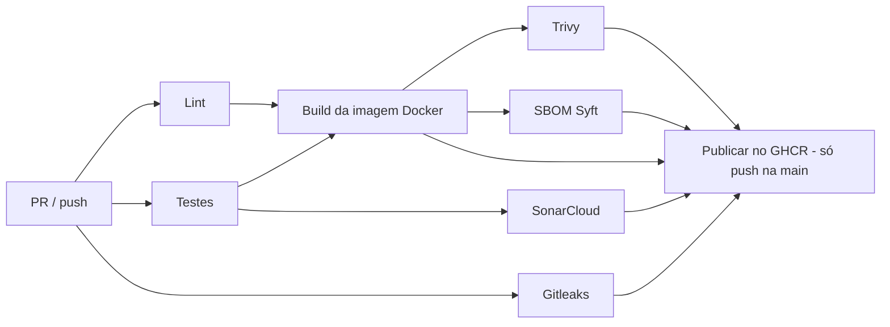
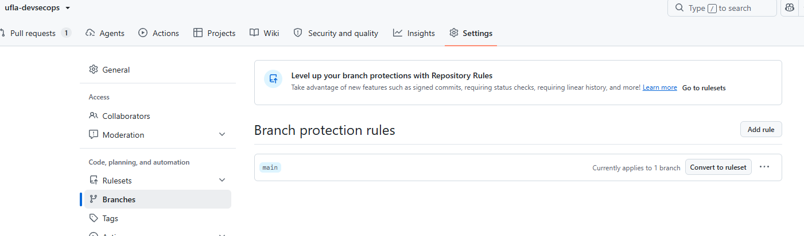
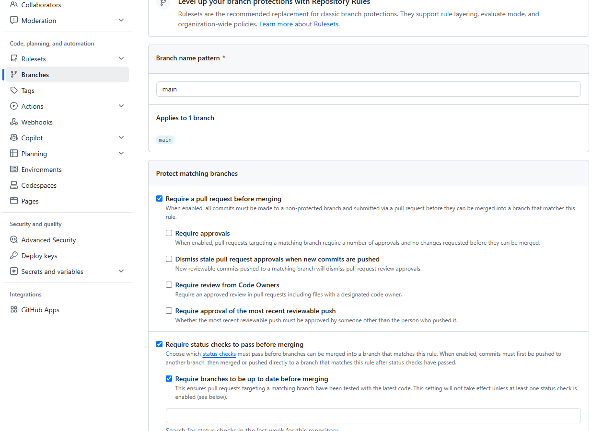
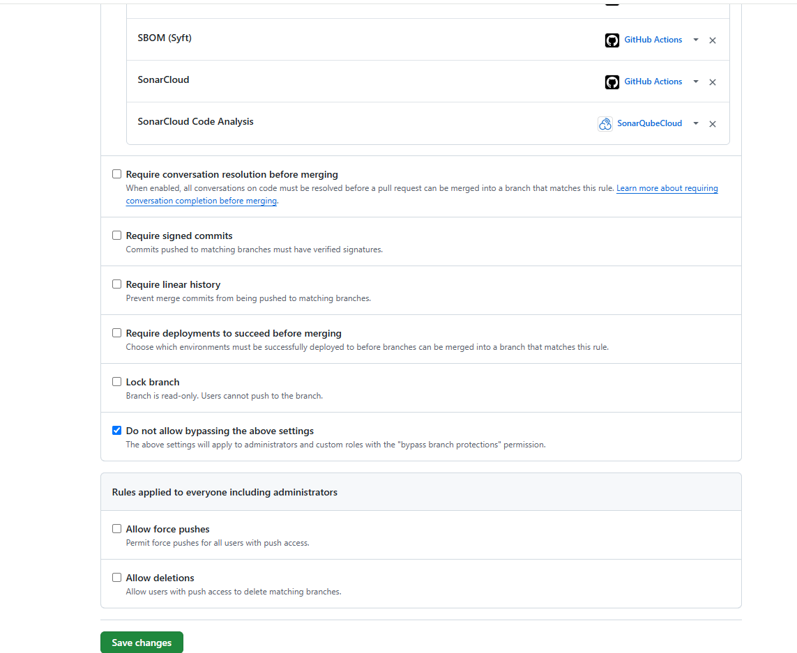
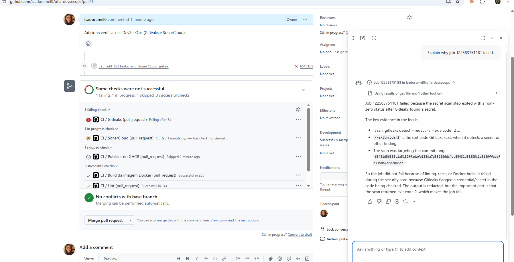
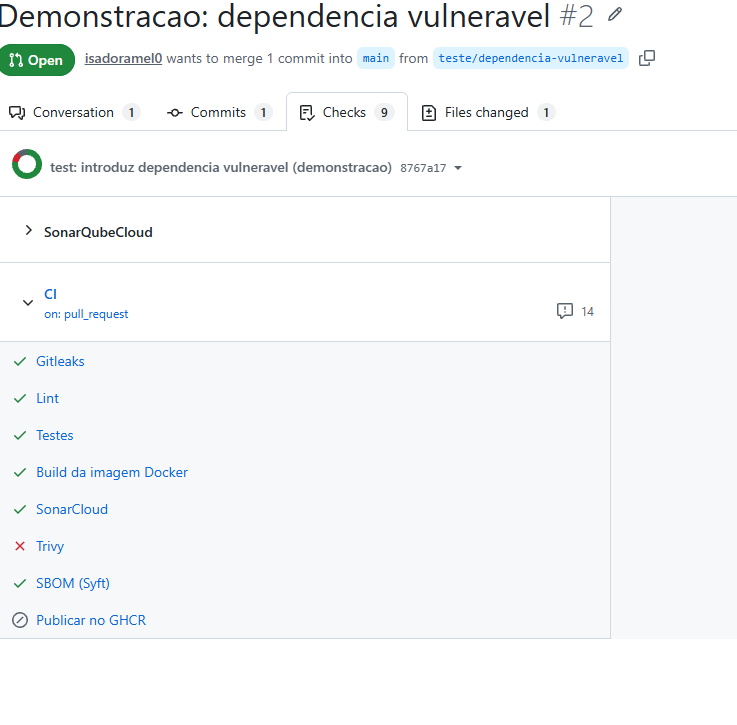
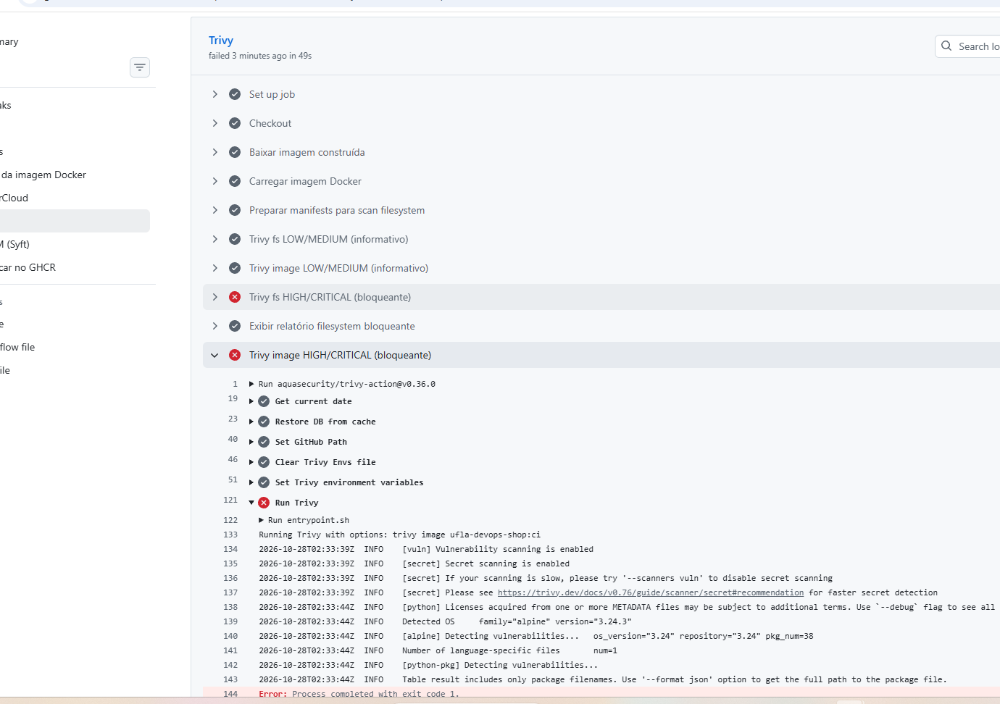

# ufla-devops-shop — Pipeline DevSecOps

Pipeline CI/CD com GitHub Actions (`.github/workflows/ci.yml`) com segurança integrada desde o início (*shift-left security*). Todas as verificações rodam automaticamente na abertura e atualização de Pull Requests para a `main` e em push na `main`. A imagem Docker só é publicada no GHCR depois que todos os gates passam.

## Jobs do pipeline

| Job | Função |
|---|---|
| Lint | Ruff (`ruff check .`) |
| Testes | pytest com cobertura (`coverage.xml` enviado ao SonarCloud) |
| Build da imagem Docker | Constrói a imagem uma única vez e a guarda como artifact (`docker-image`) |
| Gitleaks | Detecção de segredos |
| SonarCloud | Análise estática (SAST) e Quality Gate |
| Trivy | Vulnerabilidades em dependências e na imagem |
| SBOM (Syft) | Software Bill of Materials da imagem |
| Publicar no GHCR | Publica a mesma imagem escaneada, somente em push na `main` ou tags `v*` |

## Ferramentas e regras de bloqueio

| Ferramenta | O que verifica | Regra de bloqueio |
|---|---|---|
| **Gitleaks** | Senhas, tokens, chaves e outros segredos no histórico do repositório (`fetch-depth: 0`) | Falha com qualquer vazamento detectado. Sem allowlist (`.gitleaks.toml` usa apenas as regras padrão). |
| **SonarCloud** | Bugs, vulnerabilidades, code smells, hotspots de segurança e cobertura | Falha quando o Quality Gate reprova o **código novo** (*Clean as You Code*), via `sonar.qualitygate.wait=true`. |
| **Trivy** | Dependências (`requirements.txt` e `requirements-dev.txt`) e a imagem Docker construída | **Bloqueia** CRITICAL e HIGH com correção disponível (`ignore-unfixed: true`, `exit-code: 1`). LOW e MEDIUM são apenas registrados em relatório (`exit-code: 0`). Todos os relatórios são publicados no artifact `relatorios-trivy`, inclusive quando o job falha. |
| **Syft** | Componentes e versões da imagem Docker | Gera `sbom-imagem.spdx.json` (SPDX JSON), publicado como artifact `sbom-imagem`. |

O job **Publicar no GHCR** usa `needs` em todos os gates (Build, Gitleaks, SonarCloud, Trivy e SBOM) e exige sucesso de cada um. Ele nunca roda em Pull Request, então uma versão vulnerável nunca é publicada.

## Proteção da branch `main`

- Pull Request obrigatório antes do merge.
- 8 status checks obrigatórios: Gitleaks, Lint, Testes, Build da imagem Docker, Trivy, SBOM (Syft), SonarCloud e SonarCloud Code Analysis.
- Branch precisa estar atualizada com a `main`.
- Sem bypass, inclusive para administradores. Force push e exclusão da branch desabilitados.

## Evidências

### Pipeline completo na `main`
No push da `main` (merge do PR #1), todos os jobs passaram e o **Publicar no GHCR** rodou somente depois de Build, Gitleaks, SonarCloud, Trivy e SBOM (ver aba *Actions*, workflow **CI**, branch `main`).

### Gitleaks bloqueando o PR #1
Durante a configuração, o Gitleaks bloqueou o PR #1 ao detectar um valor com formato de chave (`generic-api-key`) em `sonar-project.properties`. A correção foi remover a chave literal do arquivo, sem criar allowlist:

### Demonstração do bloqueio e da correção (PR #2)

Na branch `teste/dependencia-vulneravel` foi introduzida intencionalmente a dependência `cryptography==41.0.7`, com vulnerabilidades HIGH conhecidas e com correção disponível:

| Vulnerabilidade | Severidade | Corrigida em |
|---|---|---|
| CVE-2023-50782 | HIGH | 42.0.0 |
| CVE-2024-26130 | HIGH | 42.0.4 |
| CVE-2026-26007 | HIGH | 46.0.5 |
| GHSA-537c-gmf6-5ccf | HIGH | 48.0.1 |

O Trivy falhou, os demais checks passaram e o merge foi bloqueado pela proteção da branch:

Job do Trivy falhando nos scans bloqueantes (o relatório completo está no step *Exibir relatório filesystem bloqueante* e no artifact `relatorios-trivy`):

Em seguida a dependência vulnerável foi corrigida na mesma branch, e a nova execução do PR #2 foi aprovada.

A versão vulnerável não foi mergeada nem publicada.

### SBOM

O SBOM é gerado em todo run e fica disponível em **Actions → run → Summary → Artifacts → `sbom-imagem`** (arquivo `sbom-imagem.spdx.json`).

## Configuração necessária

| Secret | Descrição |
|---|---|
| `SONAR_TOKEN` | Token do SonarCloud (*My Account → Security*), cadastrado em *Settings → Secrets and variables → Actions*. |

No SonarCloud, o projeto usa análise via GitHub Actions (Automatic Analysis desligado). A organização e a project key são passadas pelo workflow a partir do dono e do nome do repositório.
